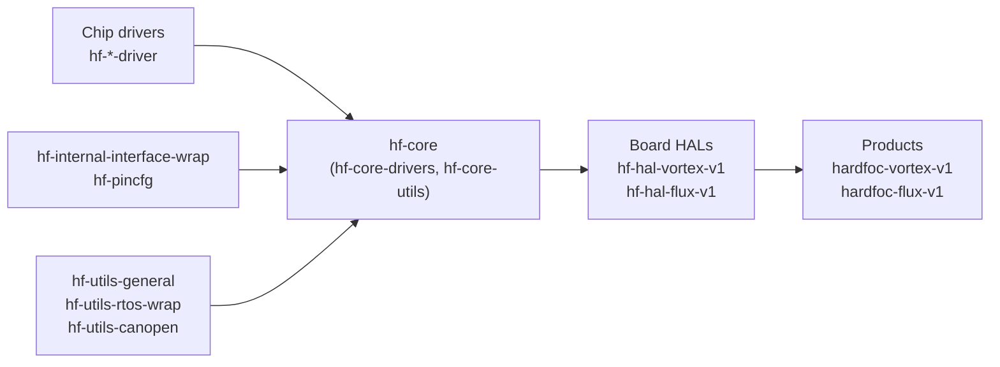

# HardFOC

Open firmware for ESP32 motor and valve controller boards: hardware-agnostic C++ chip drivers, a shared core,
board HALs and one application per board, on ESP-IDF and FreeRTOS.

**Start at the portal: <https://hardfoc.github.io/>**

HardFOC stands for hardware-based field-oriented control: motor commutation runs on dedicated FOC driver chips,
such as the Trinamic TMC9660, instead of in MCU software.

Each box is one or more repositories; each arrow is a Git submodule pinned to a commit or tag.

## What is here

- **Two boards.** Vortex V1, a motor controller (ESP32-C6, TMC9660, AS5047U encoder, CANopen), and Flux V1, a
  valve controller with on/off and proportional solenoid channels (ESP32-S3, TLE92466ED, MAX22200).
- **Chip drivers you can use on any MCU.** Each `hf-*-driver` is a C++ library with no platform code: you write
  one small bus adapter, and every driver ships ESP32 examples built in CI.
- **A shared core.** `hf-core` gathers the drivers, the peripheral interface wrap, the pin maps and the utility
  libraries (FreeRTOS wrappers, general helpers, CANopen).
- **Board HALs.** One object per board and one manager per board function, on top of `hf-core`.
- **Shared CI and documentation.** Reusable workflows and one documentation platform for every repository.

## Documentation

| Page | What it covers |
| --- | --- |
| [Get started](https://hardfoc.github.io/get-started/) | A path per board, and for a chip driver on your own MCU |
| [Repositories](https://hardfoc.github.io/repositories/) | Every public repository with its topics, documentation and latest release, searchable |
| [Architecture](https://hardfoc.github.io/architecture/) | The layers and how they are pinned together |
| [Vortex V1 HAL](https://hardfoc.github.io/hf-hal-vortex-v1/latest/) | The motor controller board: hardware, pin map, managers, examples |
| [Flux V1 HAL](https://hardfoc.github.io/hf-hal-flux-v1/latest/) | The valve controller board: hardware, pin map, managers, examples |
| [CI tools](https://hardfoc.github.io/hf-general-ci-tools/latest/) | Reusable workflows and the documentation platform |
| [Engineering standard](https://github.com/hardfoc/.github/blob/main/standards/README.md) | The rules every repository follows: layer contracts, errors, threading, naming, releases |

## Contributing

Read [CONTRIBUTING.md](https://github.com/hardfoc/.github/blob/main/CONTRIBUTING.md), the
[engineering standard](https://github.com/hardfoc/.github/blob/main/standards/README.md) and the
[code of conduct](https://github.com/hardfoc/.github/blob/main/CODE_OF_CONDUCT.md). Report vulnerabilities
privately, as [SECURITY.md](https://github.com/hardfoc/.github/blob/main/SECURITY.md) describes; never in a public
issue. Questions and announcements go to
[org-discussions](https://github.com/hardfoc/org-discussions).
