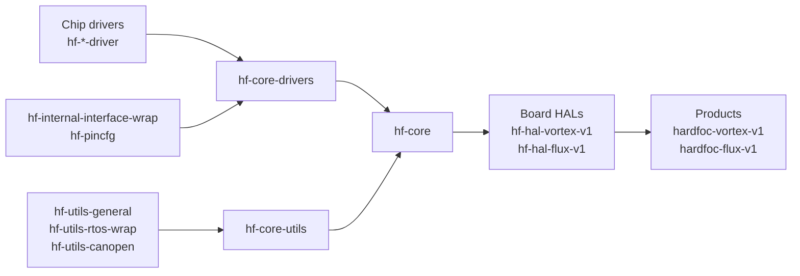

# HardFOC

HardFOC is firmware for ESP32-based motor and valve controller boards, built
on ESP-IDF and FreeRTOS. The name stands for hardware-based field-oriented
control: motor commutation runs on dedicated FOC driver ICs (such as the
Trinamic TMC9660) instead of in MCU software.

There are two boards today:

- **Vortex V1**: motor controller (ESP32-C6, TMC9660, AS5047U encoder).
- **Flux V1**: valve controller with on/off and proportional solenoid
  channels (TLE92466ED, MAX22200).

## How the code is layered

Each box is a separate repository; each arrow is a Git submodule pinned to a
commit or tag. Chip drivers have no platform dependencies and can be used on
their own.

## Repositories

### Products and board HALs

| Repo | Role |
|------|------|
| [hardfoc-vortex-v1](https://github.com/hardfoc/hardfoc-vortex-v1) | Vortex V1 motor controller application firmware |
| [hf-hal-vortex-v1](https://github.com/hardfoc/hf-hal-vortex-v1) | Vortex V1 board HAL, built on hf-core |
| [hf-hal-flux-v1](https://github.com/hardfoc/hf-hal-flux-v1) | Flux V1 valve controller board HAL, built on hf-core |

### Core

| Repo | Role |
|------|------|
| [hf-core](https://github.com/hardfoc/hf-core) | Shared platform layer: device handlers, RTOS utilities, driver integration, CANopen |
| [hf-core-drivers](https://github.com/hardfoc/hf-core-drivers) | Collects the chip drivers, interface wrap and pin config as submodules |
| [hf-core-utils](https://github.com/hardfoc/hf-core-utils) | Collects the utility libraries as submodules |
| [hf-internal-interface-wrap](https://github.com/hardfoc/hf-internal-interface-wrap) | Peripheral base classes (GPIO, ADC, I2C, SPI, UART, CAN, PWM, ...) with ESP-IDF implementations |
| [hf-pincfg](https://github.com/hardfoc/hf-pincfg) | Functional pin definitions and per-board pin maps |
| [hf-utils-general](https://github.com/hardfoc/hf-utils-general) | Header-only C++17 helpers: PID, filters, curve fitting, buffers, monitors |
| [hf-utils-rtos-wrap](https://github.com/hardfoc/hf-utils-rtos-wrap) | C++ wrappers over FreeRTOS primitives |
| [hf-utils-canopen](https://github.com/hardfoc/hf-utils-canopen) | CANopen NMT/SDO frame builders and CiA 402 helpers |

### Chip drivers

Hardware-agnostic C++ drivers. Each one takes a small bus adapter you
implement for your platform, and ships ESP32 examples and docs.

| Repo | Device |
|------|--------|
| [hf-ads7952-driver](https://github.com/hardfoc/hf-ads7952-driver) | TI ADS7952 12-bit, 12-channel SAR ADC (SPI) |
| [hf-ads9324-driver](https://github.com/hardfoc/hf-ads9324-driver) | TI ADS9324 16-bit, 16-channel simultaneous-sampling SAR ADC (SPI) |
| [hf-alicat-basis2-driver](https://github.com/hardfoc/hf-alicat-basis2-driver) | Alicat BASIS-2 mass flow meters and controllers (Modbus RTU) |
| [hf-as5047u-driver](https://github.com/hardfoc/hf-as5047u-driver) | ams OSRAM AS5047U magnetic rotary encoder (SPI) |
| [hf-at25040-driver](https://github.com/hardfoc/hf-at25040-driver) | Microchip AT25010B/AT25020B/AT25040B EEPROMs (SPI) |
| [hf-bmp581-driver](https://github.com/hardfoc/hf-bmp581-driver) | Bosch BMP581 barometric pressure sensor (I2C/SPI) |
| [hf-bno08x-driver](https://github.com/hardfoc/hf-bno08x-driver) | CEVA BNO080/BNO085/BNO086 IMU and sensor-fusion hub (I2C/SPI/UART) |
| [hf-dynamixel-driver](https://github.com/hardfoc/hf-dynamixel-driver) | ROBOTIS DYNAMIXEL X-series servos, Protocol 2.0 (UART) |
| [hf-fdo2-driver](https://github.com/hardfoc/hf-fdo2-driver) | PyroScience FDO2-G2 optical oxygen sensor (UART) |
| [hf-isf15acp4-driver](https://github.com/hardfoc/hf-isf15acp4-driver) | NKK ISF15ACP4 RGB OLED pushbutton (SPI) |
| [hf-max22200-driver](https://github.com/hardfoc/hf-max22200-driver) | ADI MAX22200 octal solenoid and motor driver (SPI) |
| [hf-mcp9700-driver](https://github.com/hardfoc/hf-mcp9700-driver) | Microchip MCP9700/MCP9700A analog temperature sensor (ADC) |
| [hf-ntc-thermistor-driver](https://github.com/hardfoc/hf-ntc-thermistor-driver) | NTC thermistors (lookup table, Beta, Steinhart-Hart over ADC) |
| [hf-pca9685-driver](https://github.com/hardfoc/hf-pca9685-driver) | NXP PCA9685 16-channel 12-bit PWM controller (I2C) |
| [hf-pcal95555-driver](https://github.com/hardfoc/hf-pcal95555-driver) | NXP PCA9555 / PCAL9555A 16-bit I/O expanders (I2C) |
| [hf-pf1550-driver](https://github.com/hardfoc/hf-pf1550-driver) | NXP PF1550 PMIC with Li-ion charger (I2C) |
| [hf-se050-driver](https://github.com/hardfoc/hf-se050-driver) | NXP SE050 EdgeLock secure element (I2C) |
| [hf-sfm-flow-meter-driver](https://github.com/hardfoc/hf-sfm-flow-meter-driver) | Sensirion SF06-family gas mass flow meters, e.g. SFM4300 (I2C) |
| [hf-tle92466ed-driver](https://github.com/hardfoc/hf-tle92466ed-driver) | Infineon TLE92466ED six-channel low-side solenoid driver (SPI) |
| [hf-tmc5160-driver](https://github.com/hardfoc/hf-tmc5160-driver) | Trinamic TMC5130/TMC5160 stepper motor controllers (SPI/UART) |
| [hf-tmc9660-driver](https://github.com/hardfoc/hf-tmc9660-driver) | Trinamic TMC9660 BLDC/stepper FOC motor controller (SPI/UART, TMCL) |
| [hf-vortex-driver](https://github.com/hardfoc/hf-vortex-driver) | CANopen (CiA 301/402) client for Vortex controllers over CAN |
| [hf-ws2812-rmt-driver](https://github.com/hardfoc/hf-ws2812-rmt-driver) | WS2812 / NeoPixel LEDs via the ESP32 RMT peripheral |

### CI and tooling

| Repo | Role |
|------|------|
| [hf-general-ci-tools](https://github.com/hardfoc/hf-general-ci-tools) | Reusable workflows: C++ lint and analysis, Markdown/YAML lint, docs publish, link check, release |
| [hf-espidf-ci-tools](https://github.com/hardfoc/hf-espidf-ci-tools) | Reusable workflows to build and release multi-app ESP-IDF projects |
| [hf-espidf-project-tools](https://github.com/hardfoc/hf-espidf-project-tools) | Scripts to install ESP-IDF and build/flash multi-app projects from a YAML config |

### Other

| Repo | Role |
|------|------|
| [hardfoc.github.io](https://github.com/hardfoc/hardfoc.github.io) | Organization website |
| [org-discussions](https://github.com/hardfoc/org-discussions) | Questions and announcements |
| [hf-drawio-diag](https://github.com/hardfoc/hf-drawio-diag) | draw.io diagram sources |
| [hf-utils-and-drivers](https://github.com/hardfoc/hf-utils-and-drivers) | Legacy; replaced by hf-core |

## Contributing

See [CONTRIBUTING.md](https://github.com/hardfoc/.github/blob/main/CONTRIBUTING.md).
Report security issues privately as described in
[SECURITY.md](https://github.com/hardfoc/.github/blob/main/SECURITY.md).
